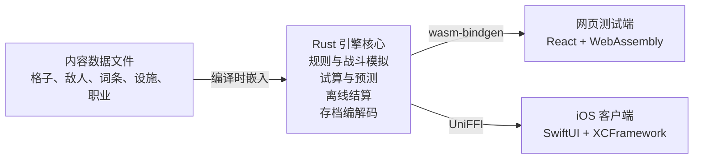

# 挂机原型设计 v1

Nov 26, 2026 · @biobot

## 概要

v1 把城市和异界合成一张 15×15 的棋盘：路线推进镇守度，驻扎抵挡来潮，居民在街区里长成职业并产出队员。数值成长交给组织和地图，个人只长本事。引擎核心改用 Rust，iOS 用原生 SwiftUI，网页作测试端。

| 评审意见 | v1 的回应 |
| --- | --- |
| 标签组合是锁和钥匙，不够涌现 | 标签三原则：既是威胁也是资源；被通用规则读取；至少一条跨到地图层 |
| 夺回街区和探索异界是同一个动作；已占街区从不受威胁 | 分成路线（巡）和驻扎（守）两种动作；边界格和领地内的异界格要抵挡来潮 |
| 开局太快，第 4 个街区撞墙 | 每多一格领地就多一段要守的边界，硬墙变成“打得下来，守不守得住”的软墙；开局先选地图 |
| 大渗透只改数值，不改规则 | 每轮重新生成地图；异界形态改变来潮的组成；地图边缘有可以打的异界核心 |
| 队员成长层太多 | 砍掉等级、熟练星级、技能树、手札特训和转职；个人只保留底子、本事、装备 |

与 [design-v0.md](design-v0.md) 冲突的地方以本文为准。

## 地图

每轮生成一张 15×15 的方格棋盘，总部在中心，离边缘最远 7 格。大小每轮不变，每轮的变化来自生成的内容。格子四方向相邻，离总部越远敌人越强，距离就是难度梯度。

| 格子 | 能做什么 | 分布与备注 |
| --- | --- | --- |
| 城市格 | 镇守度满后可占领；占领后选作民居或设施 | 内圈居多；占领时原住居民一并归入 |
| 异界格（裂隙） | 镇守度满后可镇压；产出异界资源，住着异界居民 | 外圈居多；镇压后也永远算边界 |
| 特殊格 | 地标、契约点、特别队员线索、异界核心 | 每轮随机放置 |
| 天险 | 不能通行，也不算边界 | 河、高架、封锁墙 |

- **街区**：生成时把相邻 3 到 5 个城市格划成一个有名字的街区，现有五个街区用作原型。街区是经营单位，整片占下时一次性解锁连片加成。
- **迷雾**：大部分格子开局盖着雾。路线经过哪里就揭开哪里；与领地相邻的格子永远可见，所以来潮的来源总看得见。
- **开局选图**：从 2 到 3 张预览里选一张，预览只给粗信息：天险在哪、几个裂隙、几个特殊格。
- **手机上的看法**：默认放大到领地附近约 8×8 格，每格不小于 44pt；双指缩小看全图，另有“回到领地”按钮。

## 镇守与来潮

核心原则：地图的形状只在玩家在场时改变。离线期间只累积资源、镇守度和来潮结果，全部可逆；不可逆的变化必须由玩家确认，或由玩家事先写好的规章代为确认。

**镇守度**：每格 0 到 100。城市格满了变成“可占领”，异界格满了变成“可镇压”，都等玩家确认。

**路线（巡）**

- 从领地出发连一串相邻格子，小队原路往返。
- 路线上每个未占领格打一场确定性战斗，赢了镇守度 +10；领地内部的格子只算路程。
- 经过异界格有掉落；撤退时按计划返回 100%、紧急撤退 60%、全灭 30% 带回。
- 地图形状不变时，一趟的耗时和收益固定，离线可以直接算。

**驻扎（守）**

- 队员驻扎在一格上当负责人：内部格只给设施和对应职业的人才积累加成，边界格还负责守城。
- 边界格上的设施参战，比如路障给守军 [固守]，照明让来敌带 [标记]。
- 街区里的民兵数量折成一个民兵单位，参加本街区边界格的守城战；没人驻扎的边界格也有基础防守。

**来潮**

- 边界格 = 与未占领格相邻的已占领格，加上领地内的异界格。天险旁的格子不算。
- 每个边界格每 4 小时来一潮，时间提前公布在潮汐表上，并附当前配置下的预演结果。
- 来敌是相邻未占领格的敌人组。强度再乘两个系数：全局注视度（由路线走得最远的距离决定）和本轮修正。
- 守住：镇守度不变，得到残留物。失守：镇守度 −25。
- 降到 0 为告急：这格停产，但不再下降，也不会丢格。玩家回来后可以反击、放弃或暂不处理；放弃时建筑冻结，夺回后原样恢复。
- 沿边界走的路线会把镇守度补回来，“巡防补、来潮扣”是一个可以挂机维持的平衡。所有边界格都能维持时，显示“防线自给”。

## 经营

队员从街区里长出来：居民住进民居，在设施里工作成为职业，职业积累人才，攒满一份就出一名候选队员。怎么经营，决定了手下有什么样的人。

信任同时影响人才积累、人口增长和居民迁入；异界居民走同一条链，起点换成镇压的裂隙。

**人口与职业**

- 人口按街区计算。民居提供住处，设施提供岗位，岗位在本街区内自动填满，玩家只设优先级。
- 人口有四种变化：占下一格时原住居民一并归入（不多，每格几个人）；空着的民居按信任慢慢住满；没地方住的人会慢慢离开（告急格里的住户算避难，不走）；居民从信任低的街区慢慢迁往信任高的街区。
- 人口是稀缺的：一轮的前大半段岗位通常比人多，每个居民都是一个劳力，民居和设施的比例要自己权衡。
- 职业表（测试版暂定，之后会改）：

| 居民职业 | 工作设施 | 平时贡献 | 产出的队员 |
| --- | --- | --- | --- |
| 民兵 | 哨所、路障 | 本街区守城时的民兵力量 | 街头防暴卫 |
| 巡更人 | 瞭望点 | 揭开更大范围的迷雾 | 钟楼观测手 |
| 医护 | 诊所 | 信任；告急后恢复更快 | 地下外伤医 |
| 工人 | 废材站 | 废材 | 巷战突击手 |
| 文员 | 档案室 | 情报、手札 | 异常民俗学者 |
| 工程师 | 工坊、发电机 | 零件；设施效率 | 信号改装师 |

**人才与候选**

- 人才的积累速度取决于人数、信任和培训设施。攒满一份出一名候选，属性偏向职业，词条带街区特色。
- 自然出的候选不从职业里扣人，限制速度的是人才积累。
- 定制招募（本轮有街区连片，或完成一轮后开放）：从一个街区的居民里抽人，换一名指定的候选。职业在岗满 4 人才能带新人；指定混合职业、锁一条词条、稀有度保底各要多抽人。空出的岗位由剩下的人补，要等人口长回来，所以从哪个街区抽、什么时候抽是取舍。数据见 [ideas.md](ideas.md)。
- 同一街区两种职业都过门槛时，可能出混合型候选，比如工程师加民兵出“战斗工兵”：站前排，能自己架路障给自己 [固守]。
- 招募池有上限，离线时多出的候选排队等着，不溢出也不丢。
- 队员退役后回到出身职业当教官，加快这个职业的人才积累；原来的演武室并入这里。

**信任、民居与设施**

- 每个街区一个信任值。守住来潮、通电、有服务设施时上升；告急、停电、把民居改成军用时下降。
- 每个占领的城市格选作民居或设施：民居提供人口和信任，设施负责生产、防守或服务。经营的核心张力就是宜居还是产能。
- 邻接规则只有一条：生产类设施降低相邻民居的信任，服务类设施（诊所、路灯、集市）提高。
- 信任到 60 时开放政策槽，三选一，各有代价。以钟表匠巷为例：夜间互助会（守军开局多 1 层 [固守]，工坊夜里停工）、集市日（废材 +20%，来潮强度 +5%）、学徒制（这里招到的人带精密类词条，招募变慢）。

**裂隙与异界居民**

- 镇压的裂隙有三档：开采（原晶多，往外冒的压力大，异界居民离开）、平衡、封存（几乎不产，居民沉睡）。
- 裂隙里住着异界居民，种类由裂隙决定，同样有职业和人才，攒满出异界侧特别队员。这一轮镇压了哪些裂隙，就决定能遇到哪些异界队员。测试先做 2 到 3 种。
- 人类和异界居民相邻时默认互相降低信任；“共居条例”这类政策可以把它变成加成，并开出两边混合的职业。

## 队员

个人不再堆数值，只长本事；数值成长来自设施等级、领地、总部部门和装备。测试后再调。

| 层 | 内容 | 怎么变 |
| --- | --- | --- |
| 底子 | 九维属性 | 入队时由出身职业和街区决定，之后不变 |
| 本事 | 技能和词条，槽位数由稀有度决定；战术槽数由 INT 决定 | 出身职业给初始技能；经历长出新词条 |
| 装备 | 带标签和技能，不带随机百分比加成 | 掉落；重复的自动折算成材料 |

- **经历词条**：按做过的事长出来，比如“在异界格驻扎累计 12 小时”得到“雾中识途”，“守住 5 次来潮”得到“守夜人”。档案上显示正在长出的词条和进度。测试先做 6 到 8 条。
- **砍掉**：等级、经验和技能点；职业熟练星级；职业技能树和个人树；手札特训；转职。队员的职业就是出身。
- **特别队员**：每人改一条规则，而不只是更强；跨轮保留。来源有三种：
    - 城市侧：从高信任街区的职业里产生。
    - 异界侧：从镇压裂隙里的异界居民中产生。
    - 异界侧：在探索中遇到（特殊格、异界核心、稀有掉落）。
- **解锁条件提前可见**：总部名册里放一个剪影，写明怎样能遇到他。条件要求不同的玩法，推着每一轮玩得不一样。

| 例子 | 改的规则 | 怎样遇到 |
| --- | --- | --- |
| 老邮差（城市侧） | 他所在的路线可以穿过天险 | 一轮内让一个街区信任满 |
| 雾中人（异界侧） | 他在路线上时多揭开两格迷雾，路线也能经过未揭开的格子 | 一轮内路线走到离总部 6 格 |
| 接线员（守城侧） | 他驻扎的格子所在街区，所有边界格共用这一处守军 | 一轮内守住 30 次来潮 |

## 战斗与标签

战斗保持完全确定：同样的配置永远得到同样的结果，所以预演和实际一致。骨架沿用 v0：前后两排站位，AP 主动、PP 被动，按条件优先级执行的战术规则（含撤退）。

现有标签是 [震荡] [标记] [过载] [侵蚀] [护盾] [固守]。现在每个标签只有一个专门的消耗者（[震荡] 给补枪，[标记] 给狙击），这就是锁和钥匙。棋盘方案会放大这个问题：来潮来自看得见的邻格，玩家会变成看到什么标签就换什么解法。标签按三条原则重写：

1. **既是威胁也是资源。** 例：词条“导体”受到 [震荡] 时不增伤，改为下次攻击时把层数转给目标，震荡来潮变成守军的弹药。
2. **至少被一条通用规则读取。** 例：“任意标签叠到 3 层时额外行动一次”“标签被消耗时触发”，凡是能叠层的手段都能喂它们。
3. **至少一条规则跨到地图层。** 例：设施“接地网”让本格守城战里每消耗一层 [震荡]，镇守度 +1。

- 数值全部用整数，百分比用万分比表示；模拟路径不用幂、指数这类函数，保证两端算出同样的结果。
- 随机只出现在掉落、迷雾里的发现、地图和候选队员的生成上。

## 一轮的结构与轮回

一轮约一周现实时间，第一轮就是完整的一局，有开局、中期和终局。轮回只把内容池变宽，不用来锁核心系统。

| 阶段 | 大约 | 发生什么 |
| --- | --- | --- |
| 开局 | 第 1 天 | 选地图；从知识库挑零件（实现里叫「条令」，见[玩法说明](play-guide.md)）；快反规章占下最初几格 |
| 扩张 | 第 1 到 3 天 | 揭雾、占内圈、招人；第一个街区连片 |
| 成形 | 第 3 到 7 天 | 防线成形；信任上升、选政策；镇压第一个裂隙；深入异界 |
| 终局 | 第 7 天以后 | 冲击异界核心，或把街区经营到顶；压力上升，自己决定何时收束 |

- **异界核心**：本轮异界形态在地图边缘的源头，比如静电紊流期的“紊流之眼”。路线打到那里、赢下一场带着本轮规则的战斗，就能封住它：本轮压力下降，成果大涨。这个终点是可选的，封住之后可以继续经营，也可以收束。
- **本轮成果**：收束时换成组织经验，来源有经营（信任、繁荣）、守城（守住的来潮、防线自给的时长）、探索（深度、镇压的裂隙、异界核心）和契约。各路速度相近，专属奖励不同：专心经营拿到的是城市侧特别队员、街区特色设施蓝图和政策，而不是更多经验。
- **收束防线**：玩家随时主动发起。确认页分“重置”和“保留”两栏，并按当前进度写明这次能拿到多少。
- **每轮清空**：地图和领地、居民、普通队员、未封存的装备、资源。
- **跨轮保留**：总部部门与规章、知识库（每轮挑一部分带入）、封存格里的装备、特别队员、已解锁的内容、剧情进度。
- **轮回解锁**：特别队员是主线；另有地图内容池（新地貌、特殊格、异界形态和敌人）、契约池、规章、知识库零件、剧情（每次收束后推进一段）和自选难度。
- **契约**：每轮开局或在契约点遇到 2 到 3 份，有期限、代价和回报，对方是城市各方或异界存在。例：“三天内镇压 4 个裂隙，换总部永久供电；代价是本轮注视度 +2”。第一版测试暂不做。

## 策略与爽点

策略来自三个时间尺度上的取舍；爽点在商业调研列出的那些之外，补上本作特有的几条。

| 尺度 | 做什么决定 | 主要张力 |
| --- | --- | --- |
| 每轮（几天） | 选图、扩张方向、带哪些零件、何时收束 | 伸向特殊格会拉长边界 |
| 每次上线（几分钟） | 谁跑路线、谁驻扎；路线走多深；民居和设施放在哪 | 探索深度对注视度；宜居对产能 |
| 每场战斗 | 站位、战术规则、词条和装备 | 把对面的标签变成自己的资源 |

| 爽点 | 在本作里是什么 | 第一版测试 |
| --- | --- | --- |
| 回来有礼物 | 离线清单，一夜长出的词条和候选队员 | 做 |
| 构筑组合 | 标签联动 | 做 |
| 稀缺 | 封存格、知识库容量 | 做 |
| 重置后加速 | 快反规章 | 做 |
| 世界放大 | 迷雾 | 做 |
| 数字跳变 | 街区连片 | 做 |
| 解题 | 预演由红变绿：换一个人或一条词条，失守就变成守住 | 做 |
| 连锁 | 连携按因果顺序演出，数字一路往上叠 | 做 |
| 挂机的满足感 | 防线自给 | 做 |
| 自动化解放 | 规章：用“条件 → 动作”管地图，比如“可占领的格子不会新增无人守的边界就自动占领” | 做 2 到 3 条 |
| 方向感 | 契约 | 之后 |

规章和战术规则用同一套写法：在战斗里学会的写法，到组织层再用一次。随机惊喜只放在掉落、迷雾里的发现和生成上。

## 界面

地图是主界面；没有悬停，点按打开底部弹层；任何操作在确认前都能看到后果。风格稿见[界面方向对比](https://claude.ai/artifact/YA7uUErb7i2JX2qBMtyo4i)。

**逻辑**

- 按使用频率分三层：回来看一眼在地图主屏完成；调整路线、驻扎、建设在格子或小队弹层里完成；写战术和看战报进全屏编辑器。
- 底部三个 Tab：地图、队员、总部，按进度逐个出现。
- 回来时一屏处理完：离线报告就是“待你决定”清单（占领、告急、新词条、新候选、新战报），每条点一下跳到对应格子。
- 试算：改路线、调驻扎、建设施时，弹层直接显示结果和连带影响，比如“注视度 +1，E3 那一潮会提前失守”。
- 状态靠形状区分：告急是印章，可占领是虚线框加小旗，预演写明第几波失守。

**词条联动**

- 词条和技能标出它读、写哪些标签。选中一名队员时，能接上的词条亮起；读某个标签但队里没人写它，就显示成空槽。
- 战术编辑器旁一直挂着预演，改完马上更新并标出变化。
- 连锁按因果顺序一步步演出，可以加速或跳过，但不把几步合成一步。
- 战报是可展开的因果链：每行写明哪条规则触发，点开看算式，点队员或词条筛出相关的行；另有按队员拆分的统计。算式必须和实际结果对得上。
- 关键词点一下叠出说明卡，可以逐层返回；查看和执行用不同的手势。

**引导**

- 新设施在材料攒到一半时出现，由驻扎的队员在日志里说一句用途。
- 战术编辑器从预设起步：每名队员自带一条看得见的规则；条件、动作和槽位作为里程碑奖励逐个解锁。
- 每个新系统附 1 到 3 条“做一次”的见习任务；不做脚本化的教学关。
- 只在卡住或即将犯错时提示。
- 帮助条目随机制解锁才出现，打开时跳到与当前页面相关的条目。

**名册与仓库**

- 从岗位反向选人：点开驻扎位，候选人按适配度排序，旁边写明预演变化、他现在在哪、调走会损失什么。
- 一键排班只动没锁定的人；推荐配置只填空位，不覆盖手改过的规则。
- 装备入库即判定：自动锁定或分解，冲突时锁定优先；默认只有一个“自动分解 N 级以下”的滑块，最高稀有度永不自动分解。
- 批量操作排除锁定和收藏，先列清单再确认；封存的装备自动锁定。
- 名册按“路线中、驻扎、空闲”分组，状态一直显示，不藏在长按里。

**风格**

- A+C 混合：纸面、墨线、斜线填充和异界墨迹用 A（城建测绘图）；路线用 C（线路图）的彩色粗线加站点。
- 先只做浅色。
- 图标：一套 SVG 源文件，24 网格、线宽 1.75、单色；内容数据里只存图标 id。
- 地图画法写成规格（格子几何、每种状态的画法、配色 token），网页 SVG 和 SwiftUI 各照着实现一份。

## 技术架构

引擎核心用 Rust 写一份：网页编译成 WebAssembly，iOS 编译成原生库给 SwiftUI 调用。两端只写界面，规则一行都不写在界面层。

- **绑定**：网页用 wasm-bindgen；iOS 用 UniFFI 生成 Swift 绑定，打包成 XCFramework。
- **接口**：全部是可序列化的数据，命令进、视图模型出。另有两个查询：试算（在副本上执行一条命令，返回结果但不提交）和预测（往前推 N 小时，生成潮汐表）。
- **状态分工**：界面只管视图状态（选中哪一格、弹层开没开），游戏状态只在引擎里。
- **确定性**：只用整数运算；不依赖 HashMap 的遍历顺序；随机数用自己写的、带种子的生成器。
- **内容**：格子原型、敌人、词条、设施、职业写成数据文件，编译时嵌进去，两端读同一份。
- **离线**：离散事件模拟。按时间顺序处理来潮、人才攒满、候选生成等事件，事件之间按公式跳过；在线走同一套逻辑。
- **存档**：引擎负责编码和解码，两端读写同一个字符串；带版本号和逐版迁移，另加修订号和最后写入的设备，留给以后的同步。
- **参考实现**：现有 TypeScript 战斗模拟先移植，同样的输入对拍结果。
- **本地通知（iOS）**：由潮汐表生成，只推预演失守、告急、可占领三类，可以在设置里关掉。
- **开发环境**：云端容器有 Rust 1.97，核心库和 WebAssembly 都能在那边编译测试；iOS 打包在 Mac 上。

## 第一版测试范围与待定问题

第一版测试只验证核心循环：棋盘、路线与驻扎、来潮、人口链和确定性战斗，跑在 Rust 引擎和网页测试端上。

**做**

- 15×15 地图生成（迷雾、街区、天险、裂隙、特殊格）、开局选图
- 路线、驻扎、镇守度、来潮、告急、潮汐表和预演
- 人口、6 种职业、人才和候选；2 到 3 种异界居民
- 信任、民居和设施、一条邻接规则、政策、裂隙三档
- 简化后的队员和 6 到 8 条经历词条；按标签三原则重写的一批词条和技能
- 街区连片、防线自给、预演由红变绿、连携演出、2 到 3 条规章
- 异界核心、本轮成果、收束与保留、至少 3 名特别队员
- 网页测试端（A+C 浅色）

**之后再做**：契约、自选难度、iOS 客户端、存档同步、深色模式。

**待定**（用数值模拟和试玩来定）

- 来潮间隔、镇守度增减、信任和人才的速度，按一轮约一周来调
- 异界核心的强度和奖励
- 职业表和异界居民的种类（测试版暂定）
- 本轮成果各来源的折算比例
- 第一轮的揭示顺序：哪些系统在第几天出现

## 参考

前期调研：[商业挂机游戏调研](research/commercial-design.md)、[轮回设计调研](research/prestige-design.md)、[开源挂机游戏实现调研](research/open-source-implementations.md)、[界面方向对比](https://claude.ai/artifact/YA7uUErb7i2JX2qBMtyo4i)。

界面部分借鉴的做法：

- 词条联动：[Backpack Battles 的星标](https://steamcommunity.com/app/2427700/discussions/0/4290313152638370831)、[Balatro 的逐步计分](https://blakecrosley.com/guides/design/balatro)、[圣兽之王的预测与战术](https://gamesfuze.com/guides/unicorn-overlord-best-tactics-guide-how-to-do-more-damage/)、[符文之地传说的先知之眼](https://support.riotgames.com/en-us/legends-of-runeterra/gameplay/oracle-s-eye)、[Backpack Battles 玩家的日志需求](https://itch.io/post/9580591)、[永恒之柱 2 日志算式的教训](https://forums.obsidian.net/topic/107789-no-pen-damage-calculation-doesnt-add-up)
- 引导：[A Dark Room 的建筑出现时机](https://github.com/doublespeakgames/adarkroom/blob/master/script/room.js)、[FF12 的 Gambit 解锁](https://primagames.com/eguides/final-fantasy-xii-the-zodiac-age-eguide/gambits)、[Dragon Age 的战术预设](<https://dragonage.fandom.com/wiki/Tactics_(Origins)>)、[明日方舟的见习任务](https://wiki.biligame.com/arknights/任务)、[Factorio 旧教学的教训](https://factorio.com/blog/post/fff-241)、[Antimatter Dimensions 的帮助条目](https://github.com/IvarK/AntimatterDimensionsSourceCode/blob/master/src/core/secret-formula/h2p.js)
- 名册与仓库：[Fallout Shelter 的指派净变化](https://www.gamepressure.com/falloutshelter/interface-and-icons/z57a85)、[明日方舟基建的锁定与预设](https://arknights.wiki.gg/wiki/Gameplay_and_Base_Changes)、[圣兽之王一键优化的问题](https://gamingtrend.com/reviews/unicorn-overlord-review-for-king-and-country)、[NeverSink 过滤器的严格度档位](https://github.com/NeverSinkDev/NeverSink-Filter)、[Diablo 4 “分解全部”的教训](https://dexerto.com/diablo/diablo-4-salvage-all-items-change-loot-reborn-2725179)
