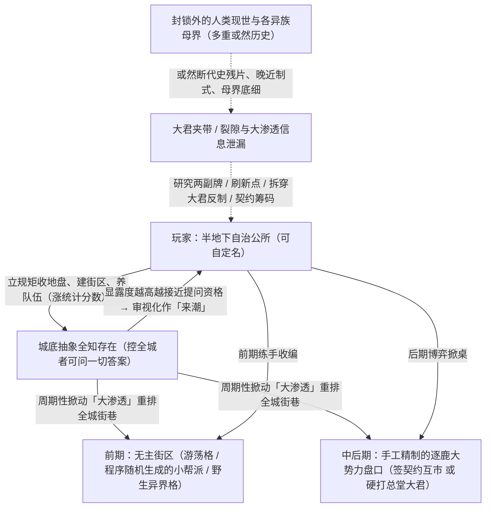

# 设计 v2：世界观与游戏元素设计

2026-11-28，独立设计定稿。汇总世界观主线、多声部叙事风味、契约落点、「6 种族 × 职业」双维体系、「随机小帮派 vs 精制大势力」分层棋盘及全球化双轨命名规范。当前暂未改写原有的 [情节和世界观草案](design-v2-story.md)、[数据层内容清单](design-v2-content.md) 与 [开发计划](design-v2-plan.md)，后续落地时按文末对照表同步并入。

---

## 一、核心基调与多声部文本风味

**世界底色参照**：《堕落伦敦》（*Fallen London*）×《血界战线》（*Blood Blockade Battlefront*）式的**全球化混血大都会**——奇诡华丽、古典钟表与异界都会日常疯狂混杂，弱化原先偏写实的“民防指挥所 × 厂矿家属院”朴素感。

**多声部文本风味（按情境选调，不用同一种腔调写到底）**：
游戏的风味文本在三种调性之间按场景自然切换、彼此反衬：
1. **市井生活气息** *(用于街区日常、居民信任、住宅/集市/诊所、队员出身与日常词条)*：写各国市民与异族街坊怎么在这座封锁城里认真过日子——柴米油盐、邻里鸡毛蒜皮、异族生理带来的生活小烦恼。正是因为街上有温热的烟火气，公所“护住这条街”才立得住。
2. **反讽与黑色幽默** *(用于公所台账、帮派摩擦、契约代价、战损汇报、大君外强中干的反差)*：见怪不怪的冷嘲与反讽——把超自然灾变、黑市扯皮、官僚遗老的荒诞行径当成日常公事记下来，天塌下来先算修墙钱和加班费。
3. **《异教模拟器》式的「或然历史感」** *(用于外界信息泄漏、档案破译、大渗透前兆、多界残卷与城底存在)*：椭圆留白、文献断章，且透出**“封锁之外不止一种可能的历史”**——漏进来的两份外界史料对同一场战争、同一个异族母界的结局可能截然相反，仿佛城外诸界的历史尚未坍缩定型，而向城底全知存在“提问”本身就关乎哪一段历史会成为现实。

**读盘与留白铁律**：
- **机制说明（直白数字与规则）与风味文本（`flavor`）严格分栏**；同屏字数克制，风味句永远控制在 1–2 句以内。
- **自治公所由玩家自行起名**（配默认名，行文内自称“公所 / 本社 / 我们”），**城市专名暂留白**（先称“这座城 / 界城”）。
- **美术暂缓**：现阶段**不动网页配色与已有 16×16 像素图标**，先把精力放在文档、机制与词表上，视觉风格留到后续阶段统一翻新。

**一段话设定**：
一场「大崩落」把整座国际化自由港大都会与异界焊死在一起，外围彻底封锁，城里的人类和各异族都成了不知道外面过了多少年的盲盒孤客。街面上高架电车照跑、夜市沙龙照开，各国市民与雾裔商贩、晶裔苦修、发条机偶挤在同一条巷子里讨生活，隔壁街口盘踞着街头帮派和野生裂隙。传说城市底层叠合着一个**抽象的全知存在**——**谁能真正掌控整座城，谁就能从它那里得到一切问题的答案**。各路界外大君与野心学阀因此把全城当棋盘逐鹿，而大君夹带的私货与裂隙偶发的信息泄漏，又时不时漏进外面人类现世与各异族母界彼此错位的断代史。你们只是从护住自家一条街起步的半地下**「自治公所」**，没牌照，靠拳头、人情与异界契约立规矩收地盘，一轮轮在棋盘上坐大掀桌。

### 多声部样句标尺

| 调性归属 | 适用场景 | 文案样句（示意，数字实际由参数传入） |
|---|---|---|
| **生活气息** | 混居街区 / 队员词条 | 梅雨周的诊所总是排长队：人类来治风湿，雾裔来领防潮绷带，机偶站在廊下借滴水声校表。 |
| **生活气息** | 集市与邻里信任 | 高架桥下的烤肉摊终于和隔壁晶裔灯匠谈拢了——油烟往西排，折光灯替他照夜摊。 |
| **反讽黑色幽默** | 开局 / 帮派摩擦 | 铁钩帮宣布这条街归他们收保护费，理由是他们人多。派人过去帮他们重新数数。 |
| **反讽黑色幽默** | 契约代价 / 官僚荒诞 | 超供契约签好了：整条街亮得像白昼，代价是值夜班的工程师偶尔会在镜子里看见下周的自己。 |
| **或然历史感** | 刷新点：外界泄漏 | 电台录到两段同日发出的城外讣告：一段说旧首都毁于灰雪，另一段祝贺女皇登基六十周年。 |
| **或然历史感** | 档案破译（前 → 后） | *破译前*：一卷浸过灰盐的晶界税册，封皮写着两种互相冲突的纪年。 *破译后*：「……在某些历史里，第七棱镜城从未陷落；它只是把自己折进镜面，等一个还没有人问出口的答案。」 |
| **冷峻交界** | 威胁审视 / 大渗透收束 | 街角的门牌开始跟对街互换。账本装箱，挑一个活人和一件家伙进密室——其余的留给下一座城。 |

---

## 二、世界观主线与核心玩法的映射

表层是**「大崩落后的群雄棋盘」**，底层引来威胁与轮回的则是**「城底抽象全知存在的审视」**。这一双层结构直接对应 Design v2 的全部核心机制：

| 游戏机制 | 世界里的说法 |
|---|---|
| **统计分数与威胁** | **「显露度与提问资格的审视」**。你的地盘越亮、生意越响、人手奇物越扎眼（分数越高），离“掌控全城向它提问”的门槛就越近，城底那个抽象存在投来的审视就越重，顺着各处裂隙涌出的**「来潮」**也越猛。 |
| **藏锋（低权重计分）** | 把物资塞进市集暗库、让队员带伤蛰伏、建筑收在库里不摆上街——在城底存在的感知里就像熄了灯的石头，能暂时避开审视，攒够底牌再亮出来冲线。 |
| **大渗透与收束（轮回）** | 当城内棋局僵持到周期节点，城底存在会掀起重排全城街巷的**「大渗透」**，一切未锚定的地盘都会错位洗牌。公所的办法是在大渗透前主动**「收束」**：退回打了锚桩的总部密室，封存限量骨干（自选保留特质）与家伙，等街巷重排停稳再推门开下一盘。 |
| **局外解锁与部门保留** | **「公所的旧档与老班底」**。街巷会重排，但总部档案室记下的异界规律、破译出的外界残史、已经搭起来的堂口部门（调度、医务、规划等）跨轮都在。 |
| **占领与告急** | **「立规矩、收街口」**。把盘踞街口的帮派或野怪打服、有人镇着场子，这条街才认公所的规矩；守不住来潮被打成「告急」，就是场子被砸、店铺关门停摆，建筑退回库房不损毁。 |
| **地块“曾经的用途”** | 每次大渗透重排街巷，地皮仍留着崩落前或某段或然历史的底子（旧诊所、废料场、印书馆、钟表坊），对口经营事半功倍。 |
| **不死人与休整读条** | 混血都会的地下铁律：被打趴下的队员由队友拖回公所读条歇口气就能爬起来（或进诊所花医药拉满）；全灭只是狼狈撤回、丢掉七成战利品。 |

---

## 三、外界信息泄漏与「或然历史」的五大作用

孤城彻底封死，唯独**大君夹带的旧物**与**裂隙/大渗透偶发的信息泄漏**，会让公所窥见封锁之外——不仅是外面人类世界的近况，也包括晶界、雾海、夜裔故国等各异族世界的历史（甚至包含彼此矛盾、尚未坍缩定型的**或然历史分支**）。这一设定直接盘活五块现有机制：

1. **拆穿大君老底（对应战斗侧「碎片与反制」及图鉴三层）**
   大君们在城里往往靠信息封锁维持某种绝对教条（如宣称母界永恒无瑕、或旧政权仍在集结反攻）。交手缴获的密档与截获的外界泄漏会拼出它们在母界/外界的真实败局或急欲抹去的或然分支——**拆穿教条破绽即揭开图鉴深层，并开发出专门克制该势力行为规则的反制学说与图纸**。
2. **合理化档案室与「研究两副牌 + 奇观」**
   档案室整理研究点的本质是破译外界漏入的或然史与博物残卷：破译**外界人类诸史**（不同可能分支下演化出的晚近工业制式与自治法令）开出装备图纸、工坊与守备学说；破译**各异族母界全盛史**开出高阶反应学说、跨族章程，乃至中后期占多格的**异界奇观**。
3. **提供「刷新点」与「迷雾迹象」的天然事件母体**
   地图随机刷出的刷新点（派替补小队处理）具象化为各类**泄漏现场**：半夜串频的城外死电台、大渗透退潮卡在巷口的异界纪年碑、从大君盘口叛逃兜售旧报的信使——根据事件类型灵活采用反讽幽默、市井八卦或或然历史残句，产出研究点、零件与图纸。
4. **制造混居街区的「故土冲击」与契约筹码（扣合「亮和藏」）**
   “老家后来怎么样了”是孤城各族最敏感的神经：将某段外界消息公开立为**街坊章程（政策）**，可让对应种族街坊安心扎根（涨信任与人才）或激发极端产能；特定种族老队员与特殊人物（如找城外收件人的「老邮差」、监听死频的「接线员」）接触故土残卷可长出**专属经历特质**；握有某位大君极力掩盖的外界黑料，还可充当签署高阶**势力契约**（或挖角其麾下骨干）的筹码。
5. **串起跨轮回的《多界或然残卷》与终极悬念**
   每次「大渗透」洗牌正是封锁最薄、外界残片漏入最多的时刻。局外档案库可逐卷拼合人类现世与五族母界的残卷（每拼齐一卷，局外永久解锁一项对应世界全盛期的遗物蓝图、奇观或开局盟约），并让玩家在多轮碎片中意识到：**封锁之外的诸界历史悬而未决，而掌控全城向城底存在“提问”，或许正是在决定哪一条历史最终成真**。

---

## 四、「契约」在现有语法里的落点

不新增按真实时间倒计时的独立系统（严格守住 [设计 v2 总纲](design-v2-outline.md)“时间不是敌人、离线放手稳定收敛”的原则），把无牌照公所靠**签契约立足**的核心设定融进现有的「装槽 / 调节 + 好处配代价」机制：

1. **供能 / 潮汐契约（对应发电与异界格「潮眼」调节）**：高阶供电与异界晶石开采来自和界外源质签下的契约——把刻度拨向「开采/超供」能白拿大量电力与晶体，代价是招来更猛的来潮或街区负面侵染；扛不住时随时可断约回调。
2. **街坊章程（对应街区「政策」）**：街区信任达标后开槽，和本街各族商户签下的自治行规（每条章程都带一项收益与一项代价，可随时更换，分三档品质）。
3. **中后期势力契约（对应大地图割据盘口交互）**：未与某大势力撕破脸开战前，可与其盘口（或凭截获的外界情报筹码）签一条特色互市/雇佣契约，开战即视为撕毁契约。
4. **界外盟约（对应开局「难度条件」）**：每轮开局主动勾选叠加的严苛条款，换取结算总分的倍率加成。

---

## 五、个体层：「6 大核心种族 × 都市职业」双维体系

打破原先将“雾行者、玻璃花匠”与“防暴卫、外伤医”混在同一层的做法，确立正交原则：**种族决定个体先天能力与生理/后勤特征，职业决定后天战斗技能组与站位**（敌我双方通用）。

### 1. 首批 6 大核心种族（扣合战斗标签与后勤流派）

| 种族 | 混居形象 | 战斗天赋方向 | 生理 / 后勤特征（对应后勤流派） |
|---|---|---|---|
| **人类（旧城人）** | 来自世界各地的本土市民与淘金客 | 属性均衡、适应力强，多一分协同/词条潜力 | 常规吃诊所**医疗**资源（标准流） |
| **晶裔（琉璃人）** | 半透明切面晶质躯体，说话带玻璃共振音 | 高防低速，入场自带薄层 `[护盾]` 或盾碎折射 `[震荡]` | 晶壳先挡伤，大幅减少生命损耗（省药抗压流） |
| **雾裔（灰盐客）** | 靠风衣、礼帽与绷带束出人形的潮雾生命 | `[侵蚀]` 亲和、迷雾视野加成 | 倒下后直接散成灰雾飘回总部，**回城读条极快**（快速复活流） |
| **发条机偶（构装体）** | 黄铜齿轮、发条芯与搪瓷外壳攒成的自律人形 | `[固守]` / `[过载]` 亲和，免疫部分生理解构 | **不吃医疗资源，改为消耗工坊「零件」修补**（工坊代医流） |
| **夜裔（狂血种）** | 体面危险的异界长生血裔，昼伏夜出 | 压低血线获得高额 `[过载]` 增伤，攻击少量汲血自愈 | 适合长期不满血作战，但重伤外治极贵（残血藏锋流） |
| **回声体（拟态者）** | 没有固定五官、靠收集城中旧声音活着的声影异族 | 擅长 `[标记]` 与**复诵**（让目标身上已有标签叠层放大） | 被动响应与连锁反应支点（高阶反应流，中后期/局外开放） |

**教学关节奏保护**：教学关可从第 2、3 名固定队员起就混入雾裔或晶裔街坊（直观立住“各族混居 + 种族×职业”），但像**发条机偶吃零件不吃药**、**夜裔控残血**这类改变基础医疗认知的种族，留到正式局再开放，不干扰教学关第 1 分半钟教医疗的节奏。

### 2. 城市职业、街区混居权重与「定制招募」

- **职业（行当）由街区 6 类属性决定**：沿用现有都市职业框架并去民防化微调——如`街头防暴卫`（守备）、`钟楼观测手`（学术）、`地下外伤医`（医疗）、`巷战突击手`（居住基础）、`异常民俗学者`（学术二档）、`信号改装师`（工坊）、`战斗工兵`（守备+工坊混合），后续补齐市集侦察/后勤职。
- **种族权重由街区位置与环境决定**：**街区人口仍只记一个总数**（不拆六本人口账），但街区的地理位置、划入/相邻的异界格、工坊档位与所装政策共同算出该街区的**异族混居权重**（例如：高档工坊街区出`发条机偶`；紧挨雾隙/潮湿码头的街区多出`雾裔`；装了共居章程或紧邻晶矿/夜市的街区引来`晶裔`与`夜裔`）。
- **消耗居民定制队员的世界观说法**：公所出面在街坊里重金寻访专才，**抽调一班街坊熟手替他打下手、凑行头（或在工坊抽人手攒一台定制机偶）**。只要本街区具备对应种族渊源与在岗行当，定制时即可点名指定**种族 + 职业 + 锁定词条**。

### 3. 特殊人物与「跨接口颠覆实体」

- **特殊人物（怪谈代号 + 真名逸事）**：采用“都市传说头衔 + 具体名姓/脾气 + 跨轮重逢短故事”塑造（如穿行天险的「老邮差」、全街共线联防的「接线员」、透雾行军的「雾中人」等），在地图刷出的异界「聚落」中结识招募，接触外界泄漏残史还能推进其身世暗线，跨局名额单算。
- **跨接口颠覆实体（局外后段逐个解锁）**：同时声明 `可出战` 与 `可放置`（既能编进小队打仗、也能当建筑摆在城区格上）的例外内容，具象化为**成精地标与活体店铺**——例如拔掉电缆就能跟队砸人的古董变电亭机偶、长脚跟队跑的移动走私当铺、本体是一座旧电话亭的回声怪。

---

## 六、棋盘与势力层：随机小帮派 vs 精制大势力

**核心同构关系**：「帮派」与「大势力」在底层都是**盘口容器（种族成员编制 + 团队战斗策略）**，区别在于规模、深度与生成方式——**帮派是程序随机生成的轻量化势力（前期练手），大势力是手工精心设计的逐鹿巨头（中后期大考）**。

| 维度 | **街头帮派（轻量势力 · 程序随机生成）** | **逐鹿大势力（巨头盘口 · 手工精心设计）** |
|---|---|---|
| **登场阶段** | 教学关（固定样例）与**初期轮回起全程都有** | **中后期大地图**随局外解锁登场（每局抽 2–3 家上桌） |
| **生成 / 设计方式** | 随地图种子**程序化拼装**，局局不同 | **手工逐家精制**世界观执念、母界黑料、专属编制与首领战 |
| **名号来源** | 词池下标组合：`[地标/器物前缀] + [帮会后缀]`（如“断桥铁钩帮”、“三号坞走私团”、“白蜡巷互助会”） | 固定招牌名号与大君背景 |
| **成员构成** | 随机抽 1–2 种常驻种族 + 街头基础职业杂兵 + 1 名随机词条组合的**帮派小头目** | 契合其政治立场的特定种族结构（纯血派 / 跨族黑市 / 人类高层）+ 专属精锐与**总堂大君 Boss** |
| **战斗策略深度** | **单层轻量策略**：从通用战术池随机挂 **1 条街头打法**（如专切后排、开场路障固守、盯标记集火、残血莽撞），教玩家看阵容换对策 | **三层递进谜题 + 大君独有规则**：①惯用标签 → ②抗性/数值偏向 → ③改写战场规则的专属行为准则（保证每家至少 3 种构筑可破，可借外界泄漏残卷研发反制） |
| **盘口规模与交互** | 占 1 格窝点（或连带邻近 1–2 格街头地盘）；无契约外交，未拔除时刷城市侧麻烦，端掉变**高价值城区格 / 黑市建筑位** | 外围堂口 + 核心总堂的成片固定割据领地（不做抢地 AI）；支持**签署专属势力契约**做买卖，或翻脸硬打总堂 |

### 1. 前期无主区的三档格子

| 格子档位 | 未占领时是什么 | 格子 Boss / 刷怪行为 | 占领 / 镇压之后变成什么 |
|---|---|---|---|
| **① 普通游荡格** | 零散流氓、游荡灰雾犬、失控路灯怪 | 无 Boss，无团队战术，一打就服 | **常规城区格**：归入原住民，带「曾经的用途」，自由摆放常规建筑 |
| **② 帮派窝点格** | **程序随机生成的街头轻量化势力**（随机旗号、混编打手、单条街头战术） | 坐镇随机词条的**帮派小头目**；未拔除时定期在周边刷城市侧麻烦 | **高价值城区格**：提供肥沃地皮加成、更多熟手原住民或特殊黑市建筑位（壮大城市侧） |
| **③ 野生异界格** | 漫出原生异界怪兽的裂口、潮眼、聚落、回廊、镜池、静区 | 深处/中心坐镇**野生源核 / 裂隙主**（如教学关北街的野生棱镜核`折光之心`） | **异界功能点**：产晶体、签潮汐供能契约、开异族聚落招特殊人物、提供免路程/双倍计建筑/清标签等奇异地貌（壮大异界侧） |

### 2. 中后期手工精制的 6 大逐鹿势力池（可扩展）

| 势力名称（暂定） | 政治与种族构成 | 团队战斗策略（三层特征） | 争城求问的执念与可拆穿的旧史切口 |
|---|---|---|---|
| **钟塔差分局** | **人类高层学阀**：前技术官僚与钟表巨匠坐镇，量产发条机偶当先锋，配人类改装枪手 | **抢先手速攻 + `[震荡/标记]` 精密集火**；总堂核心：`紊流之眼`（巨型界外演算仪） | 想算出逆转大崩落的公式；*泄漏残史暗示：大崩落当晚的第一道电闸正是钟塔自己拉下的* |
| **净琉璃圣咏团** | **晶裔极端纯血派**：晶裔大君统领，排斥一切血肉杂居，只用晶裔与晶化造物 | **重盾铁桶 + `[护盾/固守]` 折光反伤**；总堂核心：高阶棱镜圣座 | 宣称将全城化为无瑕晶体以迎母界降临；*泄漏残史揭穿：至少在一种或然史里，晶界恒星早已熄灭* |
| **灰盐暗契商盟** | **跨种族黑市辛迪加**：雾裔财阀、夜裔买办与人类老帮主合伙，认钱认契不认种 | **前排肉盾拖延 + 后排浓雾隐匿（需标记揪出）叠满 `[侵蚀]`**；总堂核心：`雾心` | 想问出万物终极定价买断全城；*泄漏残史揭穿：雾海母港早已被他们自己抵押给了更深处的债主* |
| **赤冕俱乐部** | **夜裔大君 + 各族狂徒**：追求极致感官的夜裔贵胄带着各族角斗士与疯医 | **主动压血狂叠 `[过载]` 爆发 + 队友倒下献祭强化活人** | 只想杀穿棋盘，试探城底存在能否被取悦或杀死；*泄漏残史涉及其夜裔故国被某种“答案”吞没的往事* |
| **第七回声剧团** *(局外解锁)* | **回声体 + 入戏疯伶**：内部真假难辨的怪诞戏班 | **复制我方上一回合技能 + 成倍复诵场上已有标签** | 坚信演遍全城所有人即等于掌控全城；*剧目台词里夹杂着其它或然历史里这座城的结局残响* |
| **铁幕残署** *(局外解锁)* | **人类极端排外派**：自诩正统的前军警残部，连混居的自治公所也视为异端 | **深沟路障阵地战 + 交叉火力扣减被动点（PP）封锁连锁** | 想抹除一切异界退回崩落前；*城外泄漏广播里，他们效忠的旧政权要么早已改旗易帜，要么从不存在* |

---

## 七、命名铁律：全球化混血风味词 + 最朴素功能词

为了在中文界面下兼顾国际自由港混居感、多声部叙事风味与挂机游戏的**一眼读盘效率**，严格执行双轨命名：

### 1. 功能词一律保持最朴素直白（绝不起奇诡花名）
- **资源（5+1）**：`废材`、`医疗`、`研究点`（原情报）、`零件`、`晶体` + `电力`。
- **建筑（含一、二、三级分支）与部门**：直接叫`住宅（公寓/院落）`、`废材站（分拣场/回收站）`、`工坊（装配线/修械所）`、`诊所（急救站/防疫所）`、`档案室（情报科/讲习所）`、`哨所（兵营/岗楼）`、`路障`、`集市`、`仓库`；总部部门叫`调度部门`、`医务部门`、`研究部门`、`规划部门`、`人事部门`、`守备部门`。

### 2. 风味词全面换血：全球化多语系姓名池（含全部异族）与都会地标
- **清理旧词表**：彻底移除 [content.json](../locales/zh-CN/content.json) 中偏单一年代写实的街名（供销社、煤球厂、粮站、城隍庙等）与人名（建国、国庆、桂兰、铁柱等）。
- **街区地标名池**：`玻璃拱廊`、`雾灯船坞`、`钟表匠巷`、`第七高架桥`、`黑墨印书馆`、`歌剧院后街`、`沉船干船坞`、`黄铜交易所`、`地下蓄水堂`、`断头电车场`、`半月沙龙`、`旧海关钟楼`。
- **全球化姓名基底（跨种族共享世俗文化圈）**：
  这座崩落都会原本是世界级港口，名池与姓氏池覆盖**拉美/西葡、东欧/斯拉夫、中东/阿拉伯-波斯、南亚、非洲/加勒比、东亚、西欧/北欧**等多元语系（中文译字统一选简短利落、不绕口的常见字）。**生活在城里的异界种族同样浸染在全球化世俗社会中**——普遍使用全球各语系的世俗名姓，或采用**「全球世俗名姓 + 种族特征（母语意译姓 / 工坊厂牌序列 / 声学借名）」**混搭：

| 种族 | 命名构成规则（存名字池下标组合，兼容 [i18n.md](i18n.md)） | 样例效果 |
|---|---|---|
| **人类** | 全球多语系名 + 多语系姓（偶带街头绰号） | `马特奥·席尔瓦`（拉美）、`叶莲娜·科瓦奇`（东欧）、`拉希德·哈桑`（中东）、`高桥凛` / `周默`（东亚）、`阿米娜·迪亚洛`（西非）、`索伦·林德`（北欧）、`普里娅·奈尔`（南亚） |
| **晶裔** | 全球世俗名 + 晶质意译姓/切面代称，或纯世俗名姓 | `法蒂玛·白棱`、`克劳斯·七切面`、`卢卡斯·诺瓦克`、`直树·透石`、`索菲娅·寒晶` |
| **雾裔** | 港口多语系名 + 雾港/潮汐意译姓或世俗姓 | `萨米尔·灰盐`、`伊内丝·长雾`、`胡安·门多萨`、`奥尔加·低气压`、`塔里克·暗潮` |
| **发条机偶** | 全球各地工匠姓氏/厂牌 + 世俗教名或序列号 | `温琴佐工坊·四型`、`克拉拉-07`、`佐藤重工·叁式`、`鲍里斯·止摆`、`阿比盖尔（黄铜芯）` |
| **夜裔** | 偏旧大陆多元古典名姓（东欧、地中海、波斯、拉丁等） | `米尔恰·卢普`、`卡塔琳娜·德·索萨`、`达里乌斯·赞德`、`瓦伦丁`、`莱拉·绯衣` |
| **回声体** | 借用城中各国旧住户的姓名，附声学后缀或直接沿用 | `安东的余音`、`玛丽亚（次声）`、`雷扎·第七回响`、`塞缪尔·空频`、`金敏珠（复调）` |

---

## 八、教学关四章情节校准（对应 30 分钟固定地图）

保留 [教学关](design-v2-tutorial.md) 的 7×7 棋盘与 32 步系统揭示节奏，将剧情替换为无主混乱区的立威起步：

| 章节 | 发生了什么 | 章末小高潮 |
|---|---|---|
| **第一章：立规矩**（0–8m） | 大崩落后公所只剩一名看家防暴卫。先把门口几格游荡怪与流氓清开，重开废材站与诊所，从隔壁公寓招来搭档，设好调度路线与用药线。北街口被一处盘踞变电所的**帮派窝点**（固定编排的首个小帮派样例）堵死。 | 打服窝点小头目与`变电所看门兽`，拿下肥地，通往北、东、西三面的路打开 |
| **第二章：摸门道**（8–15m） | 关口后救出被困的异族街坊`钟楼观测手`，第一次打出「震荡+标记」反应；建档案室破译第一份漏进城里的异界残卷（抽首张学说），端掉东边流窜的野生电弧巢穴。 | 连环反应端掉东侧`信号幽灵的巢` |
| **第三章：引审视**（15–24m） | 把西边地皮圈成第一个混居街区，签下首条街坊章程（政策），升二级诊所、开自动摆放。**地盘灯火一亮，城底那个“能回答一切问题的存在”第一次把视线投过来**（威胁读数出现）。 | 架起路障与哨所，守住第一次`来潮` |
| **第四章：碎野生核与收束**（24–30m） | 查明引来北面潮水的是一片折光结晶化的**野生异界格**，中心凝着野生源核`折光之心`（每回合重结盾、破盾挂满震荡）。工坊造破盾器或研究抽超频学说，敲碎源核。随后街角门牌开始错位（**大渗透将至**），公所收听到第一缕城外泄漏杂音。 | 打下`折光之心`，公所执行首次**「收束」**（挑一人选特质 + 一件家伙进密室），解锁随机大地图正式局 |

---

## 九、后续文档同步与阶段衔接对照

后续正式并入开发线时，可按以下映射推进，**不打断当前阶段 3 的开发节奏**：

1. **文档同步范围**：
   - 重写 [design-v2-story.md](design-v2-story.md)（替换民防守夜草稿，确立混血都会、全知存在、外界或然历史泄漏、多声部三调样句标尺与双轨全球化命名）；
   - 更新 [design-v2-content.md](design-v2-content.md)（重构为「6 种族 × 职业」+「程序生成的街头小帮派」+「野生异界格」+「手工精制的 6 大逐鹿势力池」+「多界或然残卷」）；
   - 微调 [design-v2-city.md](design-v2-city.md)、[design-v2-combat.md](design-v2-combat.md)、[design-v2-tutorial.md](design-v2-tutorial.md) 与 [design-v2-plan.md](design-v2-plan.md) 中的对应条目。
2. **分阶段进代码的建议节奏**：
   - **阶段 3（S7–S9，眼下）**：换上全球化多语系名字池与多声部风味提示文案，把北门关口在文案上定为首个固定帮派窝点样例，尽快跑通第一章试玩；
   - **阶段 4–6（教学关第 2–4 章 + 初期正式局）**：随重构 B3–B5 / C 段加入 `种族` 字段（先上人类、晶裔、雾裔）、研究牌的破译前/破译后残句风味，以及随机地图的**程序化小帮派生成**与野生异界格；
   - **阶段 7（正式局深度一：后勤打法）**：接入发条机偶（零件代医）、夜裔（残血藏锋）与回声体；
   - **阶段 8–9（局外后段大地图）**：接入信息泄漏类刷新点、手工精制的 6 大逐鹿势力固定盘口（含拆穿旧史的反制与专属契约）、局外《多界或然残卷》与跨接口成精地标。
